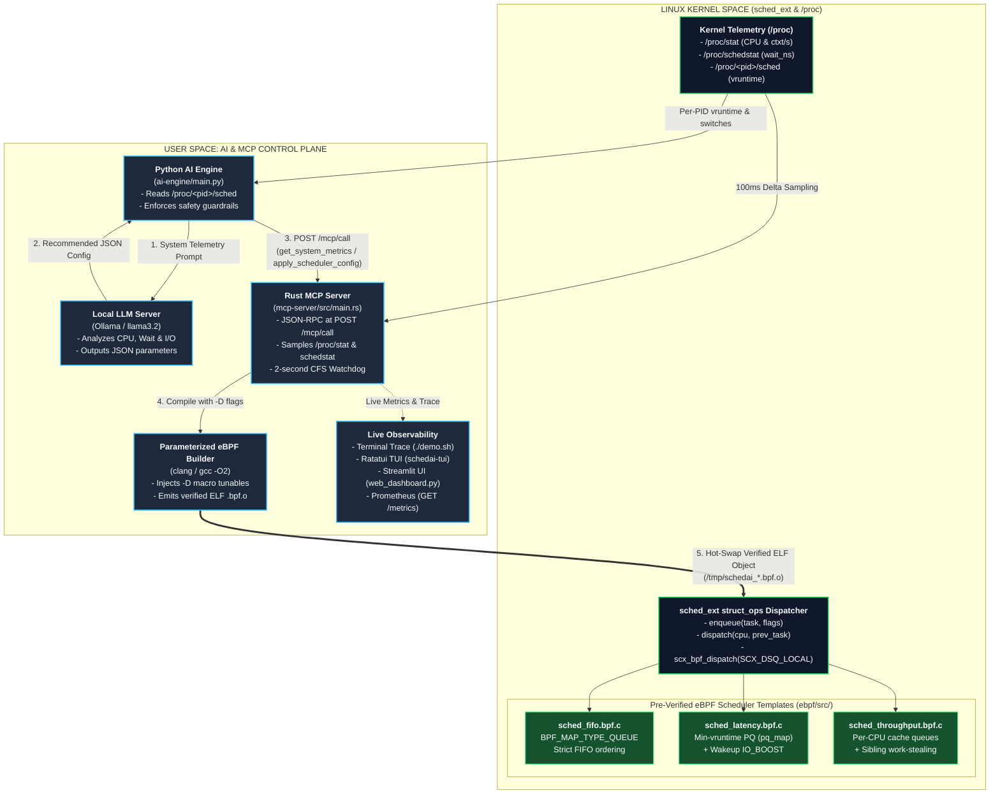
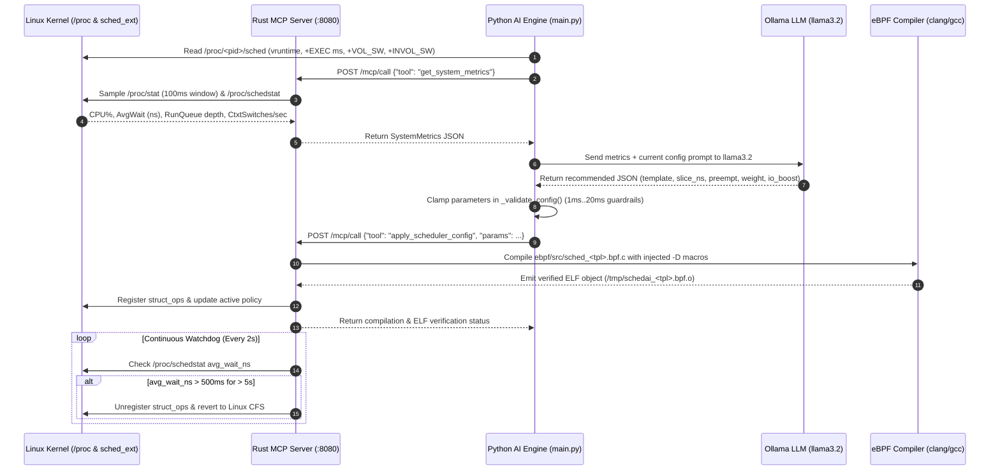

# MCP-Driven Linux Kernel Scheduler

An autonomous, explainable Linux CPU scheduling framework built on Linux `sched_ext` (eBPF extensible scheduler class), a memory-safe Rust Model Context Protocol (MCP) control plane, and local Large Language Model inference via Ollama.

---

## 1. What Problem Does This Solve? 

### The Everyday Example: Video Call + Background Code Build
Imagine your Linux machine has 8 CPU cores, and you are doing two things at once:
1. **Scenario A (Interactive Desktop)**: You are moving your mouse, typing in an editor, and on a live audio/video call. These tasks only need the CPU for **0.5 milliseconds** at a time, then they go back to sleep waiting for your next keystroke or network packet. What matters most is **wakeup latency**—when you press a key, the app must get a CPU core *immediately*.
2. **Scenario B (Heavy Batch Compute)**: Suddenly, you start a heavy background job—compiling a large C++/Rust project (`cargo build -j16`) or training a model. Now 16 heavy threads want 100% of the CPU non-stop. What matters most for them is **throughput**—running for long, uninterrupted stretches (`15 ms+`) on the same CPU core so the CPU cache stays hot.

#### What Goes Wrong with the Default Linux Scheduler (CFS / EEVDF)?
The standard Linux kernel scheduler has **one fixed policy hardcoded in C**. It tries to treat every task fairly by splitting CPU time evenly:
- **During Scenario A + B**: Your audio/UI thread wakes up when you move the mouse, but it gets stuck waiting in line behind 16 heavy compiler threads. Your cursor stutters and audio cracks.
- **During pure Scenario B**: When only the 16 compiler threads are running, the default scheduler still interrupts them every few milliseconds to switch tasks, wasting thousands of CPU cycles per second on unnecessary context switches and flushing L1/L2 CPU caches.

#### How Our MCP-Driven Scheduler Fixes This Automatically

| Workload State | Default Linux Scheduler (Static) | MCP-Driven Kernel Scheduler (Dynamic) | Result |
| :--- | :--- | :--- | :--- |
| **Interactive Use** (UI, Audio, I/O wakeups) | Treats UI threads and background jobs equally; UI waits in queue | Detects high voluntary I/O switches (`+VOL_SW`); loads **`sched_latency.bpf.c`** with a **3 ms `IO_BOOST`** and **preemption enabled** | UI and audio tasks jump to the front of the queue (`pq_map[0]`) with near-zero lag |
| **Heavy Batch Load** (Compiling, Matrix math, Video encoding) | Preempts threads every few milliseconds; high context-switch overhead | Detects >80% CPU and deep runqueues; hot-swaps **`sched_throughput.bpf.c`** with **15 ms batch slices**, **CPU cache affinity**, and **work-stealing** | Context switches drop dramatically; CPU cores spend time computing instead of switching |
| **Scheduler Stall / Bug** | N/A | Rust MCP **2-second Watchdog** detects if average wait exceeds `500 ms` and immediately reverts to standard **Linux CFS** | Zero risk of locking up the machine |

### Why Not Let the AI Write Raw Kernel C Code Directly?
Linux 6.11+ introduced `sched_ext`, which lets you load custom schedulers written in eBPF C. However, asking an LLM to write raw C code on the fly fails for two reasons:
1. **Kernel Verifier Rejection**: The Linux eBPF verifier rejects any C program with unbounded loops, unsafe pointer arithmetic, or stack usage above 512 bytes. LLMs hallucinate invalid C code that the kernel refuses to load.
2. **Speed Mismatch**: The kernel makes **20,000+ scheduling decisions per second** (nanoseconds per decision). An LLM takes **1 to 10 seconds** to generate a response.

**Our Architecture Solves Both**:
- **Inside the Kernel (Nanoseconds)**: We use 3 human-audited, pre-verified eBPF C templates (`fifo`, `latency`, `throughput`).
- **In User Space (Every Few Seconds)**: The LLM never writes C code. It reads live kernel telemetry from the **Rust MCP Server** and outputs a small JSON configuration tuning 5 safe compile-time numbers (`SCHED_SLICE_NS`, `SCHED_PREEMPT`, `LATENCY_WEIGHT`, `IO_BOOST`, `PREEMPT_THRESH_NS`), which are clamped by strict guardrails and compiled into the template.

---

## 2. Interactive System Architecture Diagrams

### 2.1 High-Level Component Architecture



### 2.2 Closed-Loop Execution Sequence (Every Cycle)



---

## 3. Repository Structure

```text
./
├── README.md                        # Problem statement, architecture diagrams, and guide
├── demo.sh                          # Single-command E2E build, test, and live 5-step trace
├── launch.sh                        # Service manager for the MCP server and AI engine
├── web_dashboard.py                 # Streamlit web interface for telemetry and dispatch logs
├── ebpf/
│   ├── include/
│   │   └── scx/
│   │       └── common.bpf.h         # sched_ext BPF types, map macros, and helper definitions
│   └── src/
│       ├── sched_fifo.bpf.c         # FIFO scheduler template (batch / uniform workloads)
│       ├── sched_latency.bpf.c      # Latency-optimized template (vruntime PQ + I/O boost)
│       └── sched_throughput.bpf.c   # Throughput template (per-CPU queues + work-stealing)
├── mcp-server/
│   ├── Cargo.toml                   # Rust server dependencies (axum, tokio, serde)
│   └── src/
│       └── main.rs                  # Rust MCP server, /proc reader, compiler & watchdog
├── ai-engine/
│   └── main.py                      # Python AI client, guardrails, and 5-step tracer
├── tui/
│   ├── Cargo.toml                   # Rust TUI dependencies (ratatui, crossterm)
│   └── src/
│       └── main.rs                  # Terminal dashboard with live Braille telemetry charts
├── scripts/
│   ├── build_ebpf.sh                # Compiles eBPF templates and verifies ELF sections
│   └── benchmark.sh                 # Synthetic workload generator for testing policy shifts
└── tests/
    └── test_suite.py                # 24 automated unit and integration tests
```

---

## 4. Deep Dive: How Each Component Works

### 4.1 Parameterized eBPF Templates (`ebpf/src/`)
Each template implements the kernel's `struct sched_ext_ops` callbacks (`enqueue`, `dispatch`, `init_task`, `exit`):

| Template | Strategy | Key BPF Maps | Compile-Time Tunables |
| :--- | :--- | :--- | :--- |
| `sched_fifo.bpf.c` | Strict First-In-First-Out queue with minimal scheduling overhead | `task_queue` (`BPF_MAP_TYPE_QUEUE`), `task_meta_map`, `stats_map` | `SCHED_SLICE_NS`, `SCHED_PREEMPT` |
| `sched_latency.bpf.c` | Shortest-virtual-runtime priority queue with wakeup priority boost for I/O-bound tasks | `pq_map` (`BPF_MAP_TYPE_ARRAY`), `vtime_map` (`BPF_MAP_TYPE_HASH`) | `LATENCY_WEIGHT`, `IO_BOOST`, `PREEMPT_THRESH_NS` |
| `sched_throughput.bpf.c` | Per-CPU cache-affine run queues with bounded work-stealing across sibling cores | `per_cpu_queues`, `task_last_cpu`, `tp_stats_map` | `BATCH_SLICE_NS`, `STEAL_THRESHOLD`, `NUMA_AWARE` |

### 4.2 Rust MCP Server (`mcp-server/src/main.rs`)
Exposes an HTTP control plane on port `8080`:
- **`POST /mcp/call` (`get_system_metrics`)**: Samples `/proc/stat` across a 100ms window to compute instantaneous CPU utilization, I/O wait percentage, and context switches per second. Reads `/proc/schedstat` to compute average task runqueue wait time in nanoseconds.
- **`POST /mcp/call` (`apply_scheduler_config`)**: Injects the validated configuration parameters as `-D` preprocessor macros, compiles the selected C template into an ELF `struct_ops` object (`/tmp/schedai_<template>.bpf.o`), registers the policy, and updates server state.
- **`POST /mcp/call` (`fallback_to_cfs`) & Watchdog**: An asynchronous Tokio watchdog checks runqueue wait times every 2 seconds. If average wait time exceeds `500 ms` for more than 5 seconds, it automatically unregisters the custom scheduler and reverts to Linux CFS.
- **`GET /metrics`**: Exposes live scheduler gauges in Prometheus format.

### 4.3 AI Optimization Engine & Guardrails (`ai-engine/main.py`)
Executes a 5-stage closed-loop cycle:
1. **Kernel Process Table Inspection (`[1/5]`)**: Reads `/proc/<pid>/stat` and `/proc/<pid>/sched` to track per-process `se.vruntime`, CPU execution deltas (`+EXEC(ms)`), voluntary context switches (`+VOL_SW`), and involuntary preemptions (`+INVOL_SW`).
2. **MCP Telemetry Collection (`[2/5]`)**: Fetches system-wide metrics from the Rust MCP server.
3. **LLM Inference & Guardrail Clamping (`[3/5]`)**: Queries the local Ollama model (`llama3.2`) or falls back to a deterministic heuristic engine if Ollama is offline. Every output parameter is clamped before compilation:
   - `template` in `{"fifo", "latency", "throughput"}`
   - `sched_slice_ns` clamped to `[1,000,000 ns (1 ms), 20,000,000 ns (20 ms)]`
   - `sched_preempt` coerced to `{0, 1}`
   - `latency_weight` clamped to `[1, 10]`
   - `io_boost_ns` clamped to `[0, 5,000,000 ns (5 ms)]`
   - `preempt_thresh_ns` clamped to `[1,000,000 ns (1 ms), 10,000,000 ns (10 ms)]`
4. **Parameterized eBPF Compilation (`[4/5]`)**: Invokes `apply_scheduler_config` on the MCP server and verifies the resulting `.bpf.o` ELF sections (`.struct_ops.link`, `.maps`, `license`) and symbols.
5. **Dispatch Trace (`[5/5]`)**: Traces task placement and slice assignment across the active `sched_ext_ops` callbacks.

---

## 5. Prerequisites

- **OS**: Linux (kernel 6.11+ recommended for `CONFIG_SCHED_CLASS_EXT` / `sched_ext`)
- **Compilers & Toolchains**:
  - `clang` or `gcc` (with `binutils` `readelf` and `nm`)
  - Rust toolchain (`cargo` / `rustc` 1.75+)
  - Python 3.10+ (`requests`, `streamlit`, `pandas` for the optional web UI)
- **Local LLM (Optional)**: [Ollama](https://ollama.com) with `llama3.2` pulled (`ollama pull llama3.2`). If Ollama is not running, the engine automatically uses its built-in deterministic heuristic policy.

---

## 6. Building & Running

### 1. Build the Components
```bash
# Compile and verify the eBPF scheduler templates
./scripts/build_ebpf.sh

# Build the Rust MCP Server and Terminal UI
cargo build --release --manifest-path mcp-server/Cargo.toml
cargo build --release --manifest-path tui/Cargo.toml
```

### 2. Run the End-to-End Pipeline
To compile the templates, verify the MCP server, run the automated test suite, and start the live 5-step terminal trace:
```bash
./demo.sh
```

To run a fixed number of optimization cycles and exit:
```bash
./demo.sh --cycles 2 --interval 2
```

### 3. Generate a Synthetic Workload
In a separate terminal, run the benchmark script to spawn parallel CPU-bound workers and observe the scheduler adapt in real time:
```bash
./scripts/benchmark.sh 20
```

### 4. Launch Dashboards (Optional)
```bash
# Terminal UI (Ratatui)
./tui/target/release/schedai-tui

# Web UI (Streamlit)
streamlit run web_dashboard.py
```

### 5. Run the Test Suite
```bash
python3 tests/test_suite.py -v
```
